# Cimora Studio 官网 UI 设计说明

版本：2026-09-19 · 图解版 · 面向 UI / 视觉 / 角色设计人员

阅读方法：先看每节配图，再读“看图说明”，最后看具体要求。截图来自当前交互原型，人物与示例均为临时素材；标注“示意”的图只解释概念，不是最终视觉稿。本文的中文说明不进入全英文官网。

> 本文以项目负责人最新确认为准。现有网页是交互与方向验证稿，不是最终视觉规范。请围绕产品概念完成布局、UI、人物与素材设计，不必复刻临时人物、代码布局细节或占位文案。

## 1. 项目是什么

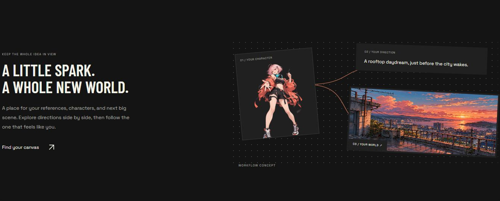

**看图说明：** 图中人物卡、文字卡和场景卡用连线组织起来，帮助访客理解“无限画布”。这是官网上的介绍图，不是让你设计完整编辑器。UI 指用户看见的界面，包括布局、字、图标、按钮和面板。

**Cimora Studio** 是正式产品名称。产品是面向动漫、游戏和漫画创作者的 AI 无限画布：用户在画布中组织角色、参考图、场景和创意，创作图片、视频及漫画内容。

三个创作方向同等重要，没有主次。产品已有相关功能；本次设计对象是产品官网宣传页，不是画布编辑器。官网应让用户理解产品、发现适合自己的创作方向，并产生进入产品的意愿。

海外优先，首要市场为美国，官网全部使用英文。本文用中文沟通，保留页面英文名称。其他国家属于后续市场研究，不进入此次设计范围。

## 2. 核心概念：主职业 → 细分角色 → 创作能力

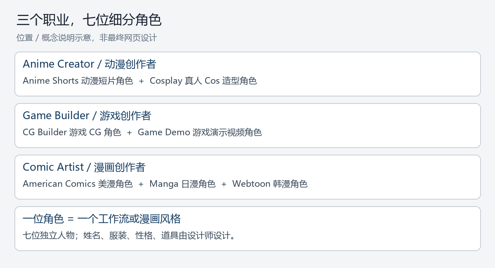

**看图说明：** 先选创作领域，再选该领域下的一位人物。工作流是“为了完成一种创作目标的一套步骤”；在官网上，一位人物就是一个工作流入口。漫画方向则按风格区分。

将创作工具的入口包装为游戏里的选职业与选角色体验。

- **主职业**：用户想在哪一类领域创作，共三个。
- **细分角色**：主职业下不同创作方向的拟人化表达；一位角色对应一个工作流或漫画风格。
- **能力**：在角色详情中，以“技能说明”的视觉形式解释这个方向能做什么。

层级如下：

```text
Cimora Studio
├─ Anime Creator / 动漫创作者
│  ├─ Anime Shorts / 动漫短片角色
│  └─ Cosplay / 真人 Cos 造型角色
├─ Game Builder / 游戏创作者
│  ├─ CG Builder / 游戏 CG 角色
│  └─ Game Demo / 游戏演示视频角色
└─ Comic Artist / 漫画创作者
   ├─ American Comics / 美漫角色
   ├─ Manga / 日漫角色
   └─ Webtoon / 韩漫角色
```

英文职业名统一使用 **Comic Artist**。首批共七位细分角色，需要七位独立人物设定，不是给同一人物换七种颜色。

### 各方向含义

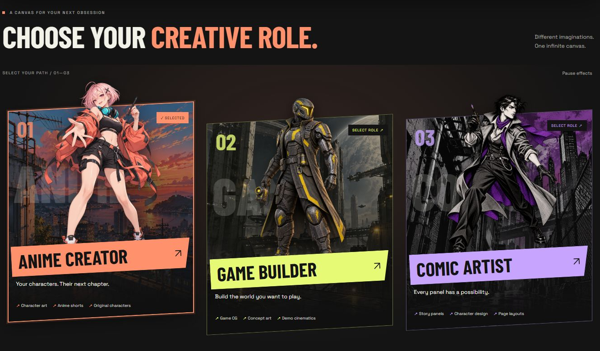

**看图说明：** 从左到右分别是动漫、游戏、漫画。图上只有三张主职业卡，不代表产品只有三位细分角色；正式人物体系共七位。

| 主职业 | 细分角色对应方向 | 设计需要表达的含义 |
| --- | --- | --- |
| Anime Creator | Anime Shorts | 将角色与故事想法表现为动漫镜头、短片 |
| Anime Creator | Cosplay | 上传真人照片，结合目标角色参考，生成本人的 Cos 造型；不是给动漫人物换衣服 |
| Game Builder | CG Builder | 游戏角色、场景、氛围及电影感 CG 视觉 |
| Game Builder | Game Demo | 游戏概念的演示视频和镜头表达；不要暗示可生成可玩的完整游戏 |
| Comic Artist | American Comics | 美漫风格，粗线条、强明暗、动态分格等可作为视觉探索方向 |
| Comic Artist | Manga | 日漫风格，线稿、黑白网点、分镜节奏等可作为视觉探索方向 |
| Comic Artist | Webtoon | 韩漫 / Webtoon 风格，全彩与纵向阅读等可作为视觉探索方向 |

## 3. 人物设计交代

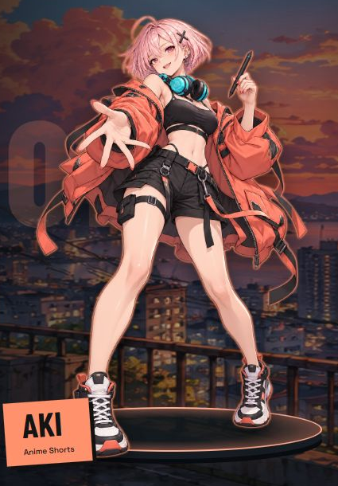

**看图说明：** 这张图说明人物全身立绘如何放在场景里，并配合轮廓光、底座和名字标签。立绘就是独立展示人物姿态的图片。当前 AKI 是临时人物，不要求沿用姓名、外观或服装。还要为每位人物单独准备小头像。

人物姓名、性别、年龄表现、服装、性格、道具、姿态及背景设定由设计师提出方案。我们限定的是职业与能力关系，不指定七位人物的具体人设。

设计目标：

1. 角色能让人联想到对应的创作能力，而不只是不同颜色的头像。
2. 七位人物在小头像尺寸下也有明显的轮廓、发型、配饰或色彩差异。
3. 每位人物需要兼顾头像选择、中心大图和右侧档案头像三个使用场景。
4. 三个主职业可以拥有独立画风与场景，不要求共享世界观。UI 框架和交互规则保持统一。
5. 角色识别色应联动头像选中框、角色强调效果、档案卡、能力图标和按钮；不要只用颜色区分人物。


上层三个主职业各需一张主角色卡。卡面采用代表人物、组合构图或其他职业表达方式，由设计师提出；不预先增加三位额外人物的制作要求。

**是否采用 3D 后续决定。** 当前游戏机器人仅为交互试验，不是美术参考或最终形象，本次不要把 3D 模型与动画制作当作已确定的交付要求。

## 4. 官网页面结构

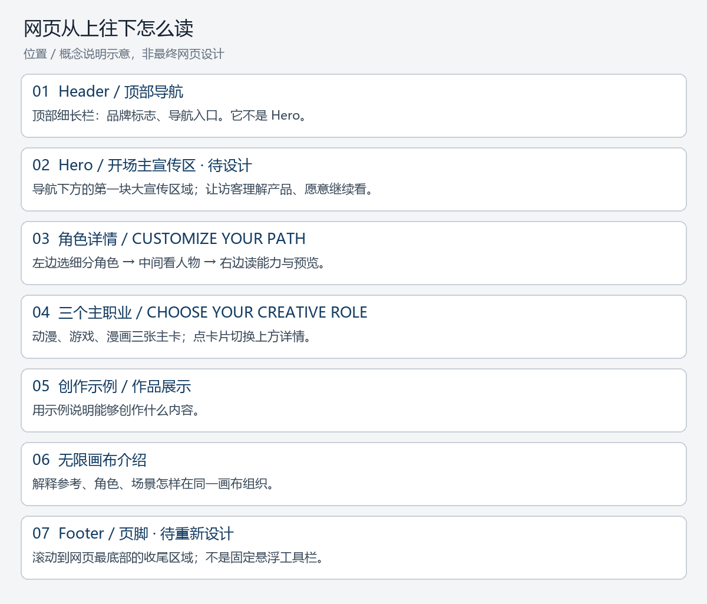

**看图说明：** 从上往下依次阅读，图中顺序是要求，框的高度与外观不是要求。Section 就是一块有独立主题的页面区域。Hero 和 Footer 的具体画面由设计师设计。

当前确认的页面顺序：

| 顺序 | 板块 | 设计任务 |
| --- | --- | --- |
| 1 | 顶部导航 | 品牌识别、必要页面入口和产品入口，融入整体视觉 |
| 2 | **Hero，待补充** | 必须有此板块；构图、人物使用、文案层级与表现形式由设计师设计，不预设群像或按钮方案 |
| 3 | **角色详情 / CUSTOMIZE YOUR PATH** | 页面核心游戏化展示：左侧细分角色、中间人物、右侧档案 |
| 4 | **主职业选择 / CHOOSE YOUR CREATIVE ROLE** | 三张主职业卡固定站位，点击切换上方详情 |
| 5 | 创作方向与作品展示 | 展示不同方向可以创作的内容，版式及素材由设计师深化 |
| 6 | 无限画布介绍 | 表达参考、角色与场景如何在同一画布中组织；不是编辑器完整界面设计 |
| 7 | **Footer，待重新设计** | 重点是符合整体风格的收尾样式、层级和视觉完整性；具体链接、社交账号与法律文案此阶段不锁定 |

角色详情位于三张主职业卡上方，这是已经调整确认的顺序。它与用户“选择主职业，再探索细分角色”的逻辑层级不同；设计时需让上下两块之间的联动容易理解。

Hero 尚未设计。现有底部简易页脚不代表 Footer 已完成。其余板块已有原型，可作为内容与交互参考，不能视为最终版式。

### 整页截图：先看全局，再看各个模块

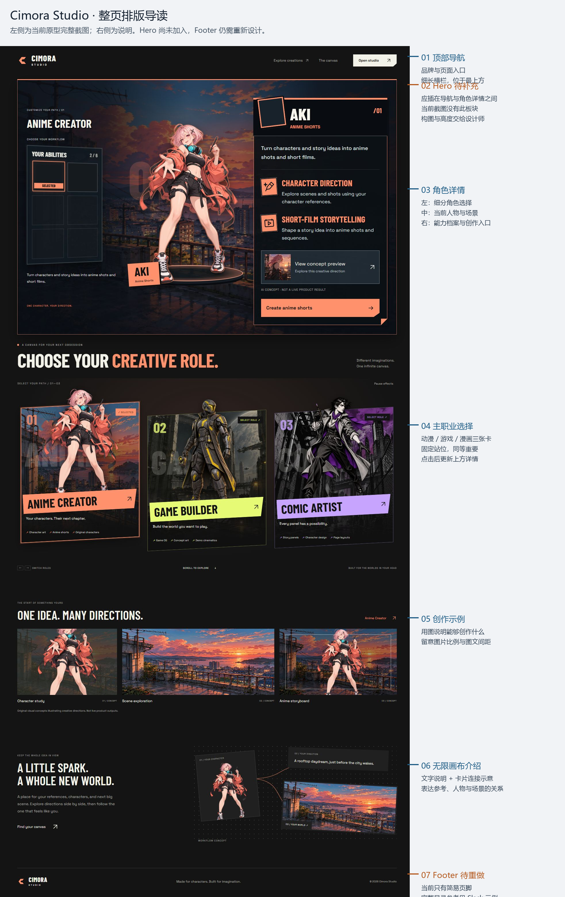

**看图说明：** 左侧是 2026-09-19 采集的当前桌面原型完整截图，右侧按页面顺序标注。先看模块的上下关系、内容宽度、留白和大图节奏，再阅读下方局部截图。此图用于解释排版关系，不固定最终尺寸。

**注意缺失位置：** 导航下面应补 Hero，截图现在直接进入角色详情；最下方仍是简易 Footer，需要参考下面的完整目录例子重新设计。插入 Hero 和重做 Footer 后，整页高度会改变，不能把本截图当最终页面长度。

[查看未加标注的完整原型截图](design-references/current-page.png)

### 4.1 顶部导航：网页最上面的一条

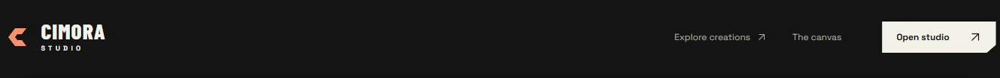

**看图说明：** 左侧是品牌，右侧是页面入口和产品按钮。Header 是页头，Navigation 是导航；本项目这两部分放在一起。它与下面的大幅宣传区域不是同一块。

### 4.2 Hero：网页开场的主宣传区（待设计）

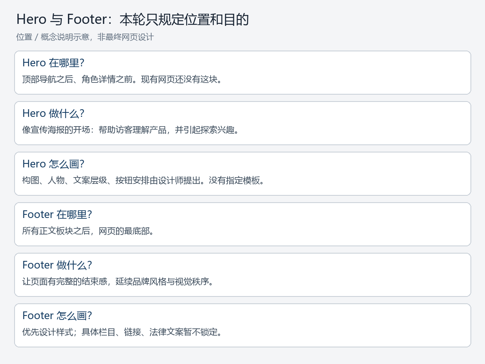

**看图说明：** Hero 不是“英雄角色”，而是导航下面的主要宣传区域。访客第一次打开官网，就应从这里理解我们是什么。现有网页没有这个模块，因此这里用解释示意，不能提供真实的已完成截图。具体布局、画面、文案和按钮由设计师提出。

### 4.3 创作方向与作品展示：给访客看例子

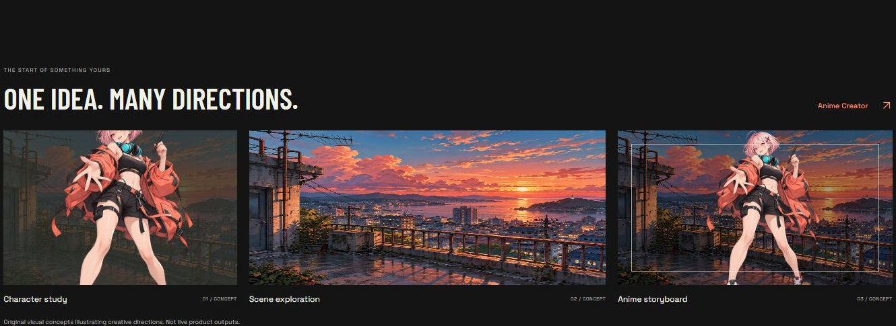

**看图说明：** 图中并排展示人物、场景和分镜示例，让用户看到可能创作的内容。这些是临时概念图，不是已经验证的产品生成结果。设计师需要设计图片构图、图文关系及不同方向的素材。

### 4.4 无限画布介绍：解释素材如何组织


**看图说明：** 用分散的卡片和连线表达角色、参考与场景在一个空间里组织。设计的是官网宣传展示，不需要交付完整编辑器、上传或生成操作界面。

### 4.5 Footer：网页最底部的收尾区（待重新设计，这是给参考，需求是做统一风格的footer）

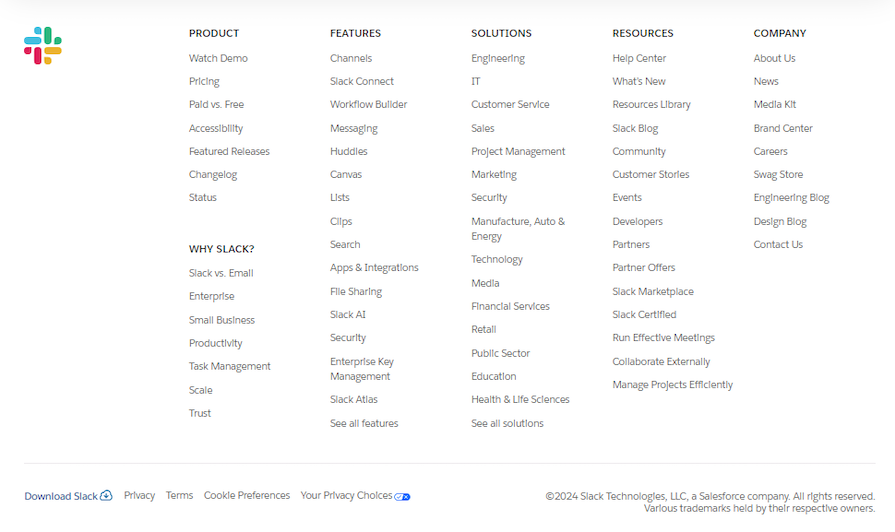

**看图说明：** 这是一张有完整目录结构的 Footer 参考。把它理解成网页最底部的“分类目录”，用户看完正文后，可以继续找到产品、功能、资源、公司等入口。它随页面滚动到底部出现，不是一直悬浮在屏幕底边。

| 图中位置 | 是什么 | 设计师看什么 |
| --- | --- | --- |
| 左上角彩色标志 | 品牌区 | 用品牌标志标明网站归属，与目录之间留出空间 |
| 中间五列 | 分类目录 | Product（产品）、Features（功能）、Solutions（解决方案）、Resources（资源）、Company（公司），每列有清楚的标题 |
| 每列标题下方 | 子链接 | 一行一个入口，同列左对齐；标题与链接区分字重或颜色，列与列之间保留间距 |
| 横向分隔线以下 | 辅助信息区 | 下载、隐私、条款、偏好设置、版权等与主要目录分开，视觉层级更低 |

**用于 Cimora 的方式：** 参考“品牌区＋多列目录＋底部辅助信息”的组织方法。列数、具体目录和链接不在本轮锁定；设计师可以用占位内容展示排版。外观仍要融入 Cimora 的游戏选角、深色界面与贴纸语言，无需沿用 Slack 的白底和品牌元素。手机版需要重新排布栏目，不能把所有列等比例缩小。

**来源与时间：** [LogRocket：Website footer design best practices](https://blog.logrocket.com/ux-design/website-footer-design-practices/) 中的 Slack Footer 示例；文章标注更新于 2024-12-02，截图底部版权为 2024。2026-09-19 收录到本文，作为历史排版参考，不声称是 Slack 当前线上版本。截图品牌及界面归原权利人所有，仅作设计沟通参考。


## 5. 核心板块：角色详情

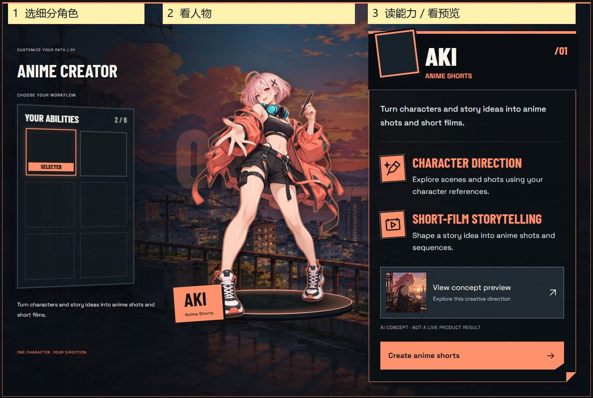

**看图说明：** ①左边选择某位细分角色；②中间看这个人物；③右边了解能力、查看效果并进入创作。三部分属于同一个场景，切换左边选项后联动更新。截图文字与人物都是原型素材。

桌面端基础构图：

```text
┌────────────── 完整场景背景 ──────────────┐
│ 左：职业标题    中：当前细分角色    右：角色档案 │
│ 角色头像选择        人物大图          名称/方向  │
│ 说明短文          轮廓光/底座         两项能力  │
│                                     效果预览  │
│                                     创作按钮  │
└───────────────────────────────────────┘
```

### 5.1 左侧：YOUR ABILITIES

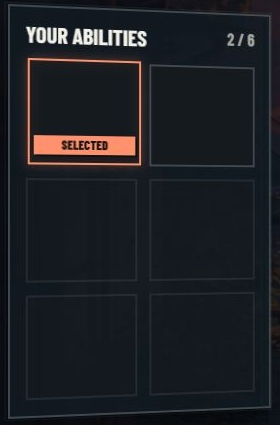

**看图说明：** 上方 YOUR ABILITIES 意思是“你的能力”。下面六格用来放头像，SELECTED 表示已选中。当前头像尚未填入，不能因为格子都是空的就认为六格都可点。这里不显示工作流名称。

- 深色半透明的头像选择面板，桌面两列三行，共六个槽位。
- 标题为 **YOUR ABILITIES**。
- 动漫职业当前有两个有效选项，游戏两个，漫画三个；剩余槽位仅为空位，不可点击。
- 六格是界面预留容量，不代表每个职业必须制作六位角色，也不代表总共十八位人物。
- 未提供头像前可留空；正式设计需填入对应人物头像。
- **槽位内不显示 Anime Shorts、CG Builder、Game Demo 等名称**。选中后的角色身份与创作方向在右侧展示。
- 选中框使用角色主题色、适量外光和 `SELECTED` 标签。
- 面板整体轻微侧向透视，当前确认桌面约 **8°**；不再采用影响阅读的大角度。
- `SELECTED` 与面板处于同一透视方向，不额外单独斜转。
- 说明短文位于框外，保持正向可读。

### 5.2 中间：人物舞台


**看图说明：** 关注人物轮廓、姿态、落地阴影及背景对比。轮廓光是人物边缘的强调光；底座帮助人物站稳。它们可以重新设计，不要求照着截图画。

- 显示当前细分角色，优先保证人物轮廓、姿态和职业辨识度。
- 人物应是第一视觉焦点，不能被右侧档案或背景细节压过。
- 可用主题色轮廓光、底座或落地阴影让人物与场景建立关系。
- 切换细分角色时，人物、识别色及右侧档案联动；当前“同一角色换色”只是原型过渡，正式素材应表达独立人物。
- **Cosplay 的中间仍展示设计的虚拟角色，真人效果只出现在右侧效果预览中。**

### 5.3 右侧：角色档案卡

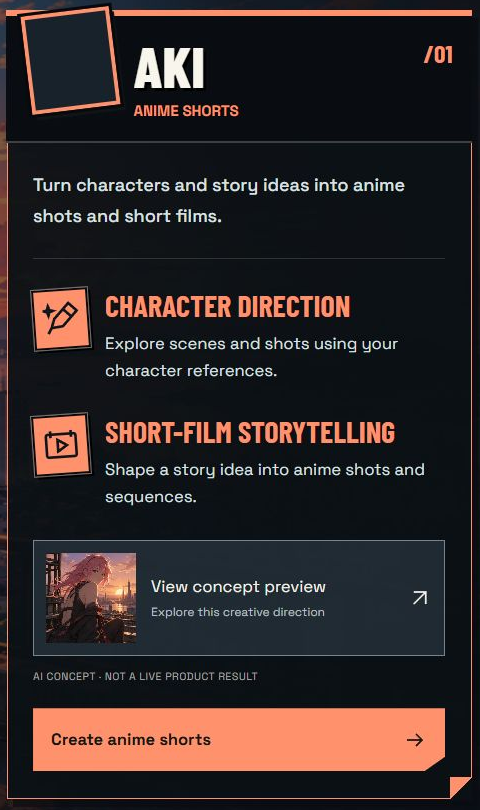

**看图说明：** 由上至下看：头像和名字 → 一句介绍 → 两条能力 → 小预览 → 创作按钮。CTA 指引导用户采取行动的按钮，例如 Create anime shorts。点击缩略图后出现的大图窗口叫预览弹层。

参考游戏人物资料与技能面板，而非一张常驻的大作品图。

从上到下：

1. **身份栏**：略微破框的头像、醒目角色名、所属工作流或漫画风格。黑底为主，主题色作为边条与强调。
2. **一句定位**：简短说明这位角色对应的创作方向。
3. **两项核心能力**：图标＋能力标题＋简短解释。使用游戏技能的视觉语言，但内容描述实际创作能力，不编造战斗数值或功能保证。
4. **效果缩略预览**：默认收起为较小的缩略入口，点击展开大图。
5. **创作按钮**：对应当前角色的创作入口，视觉上与档案卡连为一体。

详情卡整体正面显示。头像与小标签可有轻微贴纸感，正文不做影响阅读的倾斜。此前已因文字偏小整体放大，正式设计需要保留较大的阅读尺度，不照搬参考图的小字号。

Cosplay 展开预览展示「真人原照＋目标角色参考 → 真人 Cos 效果」。预览支持明确关闭按钮和键盘关闭。

## 6. 主职业选择板块


**看图说明：** 左动漫、中游戏、右漫画，三个方向同等重要。选中标记只表示用户目前在看哪个方向，不是优先级。卡片可以有自己的画风，但尺寸关系、标题与交互表达应统一。

- 左：**Anime Creator**；中：**Game Builder**；右：**Comic Artist**。
- 三张主卡同屏展示、位置固定。选中卡不搬到中间，也不重新排序。
- 各卡保持自己的画风、角色表现与场景；统一卡片结构、名称标签和选中规则。
- 角色可适度突破卡框，名称使用有力度的斜切标签。
- 悬停只做轻微反馈；点击才正式切换，避免鼠标经过就改变整页内容。
- 选中卡可抬升、描边，其他卡保留颜色与辨识度。
- 选择后更新上方职业详情及相关展示内容；三张主职业卡本身保持各自的代表形象。
- 每个主职业记住当前浏览期间上次选择的细分角色。

## 7. 视觉方向


**看图说明：** 背景铺满模块，人物居中，左右面板放在上层。关注深色底、亮色描边、切角、贴纸式头像与大标题。半透明是能隐约看到后面背景；切角是把矩形角切去一小块。当前颜色只是探索。

关键词：**街头漫画、游戏选角、角色舞台、贴纸式信息卡、深色界面、鲜明识别色。**

| 要素 | 设计方向 |
| --- | --- |
| 背景 | 完整场景铺满详情模块，不只在人物背后放一小块；左右信息区域局部压暗 |
| 层级 | 场景为底，人物居中，左右面板悬浮其上，形成同一空间中的整体 |
| 色彩 | 黑白与深色作基础；每位角色一种主要识别色，贯穿选中、轮廓和操作 |
| 字体 | 标题可粗、窄、斜并配适度阴影；英文正文保持清晰，不用装饰字承担长说明 |
| 面板 | 半透明暗底、明确描边、切角、错位贴纸，避免全部堆成厚重纯色块 |
| 图标 | 较粗轮廓、双色、贴纸感；与头像框和档案视觉一致 |
| 阅读 | 大小、对比度与行距优先；不能为“像游戏截图”牺牲网页实际阅读 |
| 动效 | 选中反馈、切换过渡为主，不依赖持续晃动；需要静态也成立的视觉 |

当前色彩是方向探索，不是冻结的品牌色：动漫用珊瑚/青蓝，游戏用琥珀/电光蓝，漫画用橙红/紫/青绿。设计师可结合正式人物重新组织配色。

参考图用于提炼结构、气质与视觉语言，不直接复制其中游戏的角色、名称、标志、排名或其他无关功能。

## 8. 移动端与交互状态

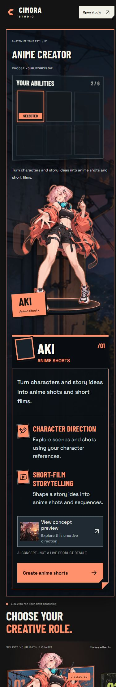

**看图说明：** 手机宽度小，角色选择、人物、档案沿上下阅读，不能直接缩小桌面三栏。此图只解释重排方式，间距与视觉仍由设计师优化。悬停是鼠标停在上面，聚焦是键盘 Tab 选到控件，选中是点击后持续保留的状态；三者要区别。

- 不能把桌面三栏机械缩小。建议按角色选择、人物展示、档案信息组织阅读。
- 主职业卡保持原顺序，可横向滑动并露出下一张的边缘。
- 细分角色槽位可以三列两行，透视减弱，保证可点区域与识别度。
- 档案卡保持大字与完整内容；展开预览应适合竖屏，关闭入口明确。
- 需要设计：默认、悬停、键盘聚焦、选中、空槽位、预览展开及关闭状态。
- 动效不能是理解选中状态的唯一依据；用边框、标签等同时表达。

## 9. 设计交付清单

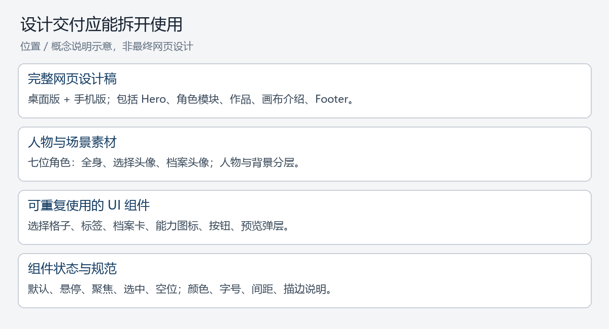

**看图说明：** 页面稿说明东西放在哪里，人物素材说明长什么样，组件说明按钮和面板如何复用，状态稿说明点之前和点之后的变化。分层是让人物、背景、文字分别可编辑，不交付一张全部合并的长截图。

| 类别 | 本次需要交代/设计的内容 |
| --- | --- |
| 页面 | 完整桌面与移动端布局，包含待补的 Hero 和 Footer |
| 职业卡 | 三个主职业的卡面与选中/未选中状态 |
| 人物 | 七位细分角色的设定方案、全身展示形象、选择头像与档案头像；正式命名由设计师提出 |
| 场景 | 三个职业的独立场景方向，以及角色/主题色联动时的视觉规则；不强制七张背景 |
| 核心组件 | 六槽位面板、SELECTED 标签、角色档案、能力图标、按钮、效果预览入口与展开视图 |
| 效果素材 | 动漫、Cosplay 对照、游戏 CG、演示视频视觉、美漫、日漫、韩漫各方向的示例设计 |
| 视觉规范 | 颜色、字体层级、描边、切角、阴影、透视及动效说明 |
| 素材整理 | 人物与背景分层，头像/人物独立导出，明确对应职业与细分角色；不把整套 UI 烘焙为一张不可编辑图片 |

## 10. 已确定与留给设计师的空间

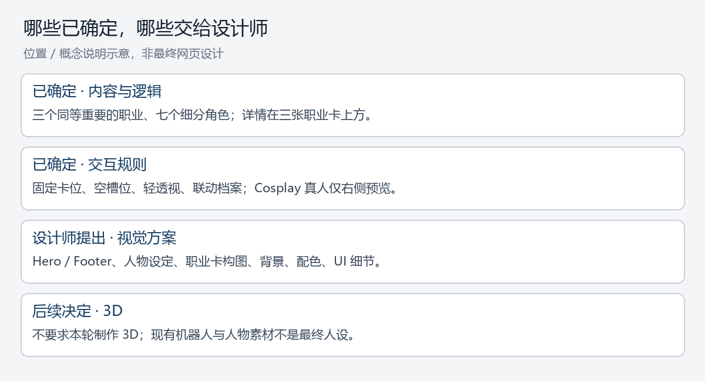

**看图说明：** 先按已确定的产品关系做方案，再自由设计人物与视觉。截图用于理解位置与作用，不是要求逐像素照抄。3D 仍待决定。

**已经确定：** 正式品牌名、全英文官网、美国优先、三个职业同等重要、七个细分角色对应关系、详情在主职业卡上方、固定卡位、完整场景方向、空槽位逻辑、轻透视、角色档案与展开预览、Cosplay 真人示例位置。

**由设计师提出：** Hero 的完整方案、Footer 风格、正式角色设定与命名、主职业代表构图、具体场景、美术风格、最终配色、组件细节与响应式优化。

**后续再决定：** 是否使用 3D 角色展示及其覆盖范围。无需在本轮自行承担 3D 制作要求。

**不要将原型误认为最终要求：** 当前人物重复使用及换色、七个选项共用三个临时名字、概念示例图片、简化机器人和现有英文营销文案。最终设计应围绕本文件的角色体系深化。

原型入口当前为占位交互。设计稿需要呈现可理解的创作入口，但不需要设计生成、上传或登录等产品内部流程。Footer 具体栏目及最终营销文案可在视觉方案确定后补充。